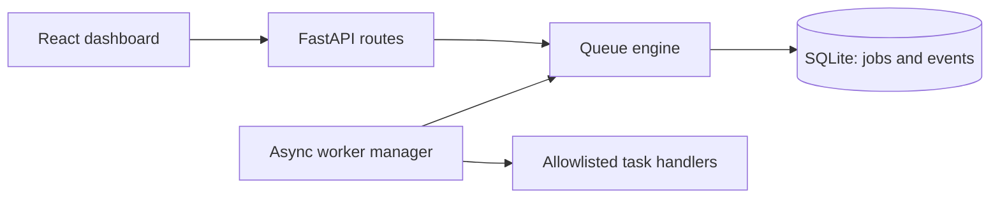

# QueueForge

QueueForge is a locally runnable, SQLite-backed message queue MVP. It demonstrates durable job publishing, atomic worker claims, ownership-checked acknowledgements, retries with exponential backoff, lease recovery, a dead-letter state, and a live operations dashboard.

This is an educational **single-process/local SQLite system**, not a production distributed broker. Delivery is at-least-once: task side effects may repeat after a worker crashes before acknowledging a job.

## Features

- Durable queue and event history in SQLite with WAL and a busy timeout.
- Atomic claim/recovery transactions and monotonically increasing fencing tokens.
- Retry scheduling with a one-second base and 60-second maximum delay.
- Three allowlisted, input-validated demo handlers.
- FastAPI API and managed concurrent worker loops.
- React dashboard with live queue state, filtering, job inspection, real activity data, worker controls, and demo workload.
- Temporary-database backend tests and frontend API-client tests.

## Architecture



See [docs/architecture.md](docs/architecture.md) and [docs/delivery-guarantees.md](docs/delivery-guarantees.md) for state transitions, transactional behavior, and limitations.

## Repository layout

```text
backend/app/       FastAPI, SQLite engine, schemas, worker runtime
backend/tests/     Queue state, concurrency, and API tests
frontend/src/      React dashboard, API client, types, and tests
docs/              Architecture and delivery-guarantee documentation
```

## Prerequisites

- Python 3.11 or newer (verified locally with Python 3.12).
- Node.js 20 or newer and npm.

## Run locally (Windows PowerShell)

From the workspace root:

```powershell
cd backend
python -m venv .venv
.\.venv\Scripts\Activate.ps1
python -m pip install -r requirements.txt
uvicorn app.main:app --reload
```

In another PowerShell window:

```powershell
cd frontend
npm install
npm run dev
```

Open the Vite URL (normally `http://localhost:5173`). The API is at `http://127.0.0.1:8000`; interactive API documentation is at `http://127.0.0.1:8000/docs`.

Set `QUEUEFORGE_DATABASE` to select a database file. It defaults to `backend/queueforge.sqlite`, independent of the shell's current directory. Set frontend `VITE_API_BASE_URL` to override the default `http://127.0.0.1:8000`.

macOS/Linux use the same commands with `python3 -m venv .venv`, `source .venv/bin/activate`, and the same Uvicorn/npm commands.

## API reference

| Method | Path | Purpose |
| --- | --- | --- |
| GET | `/health` | Service health |
| POST | `/api/jobs` | Publish an allowlisted task |
| GET | `/api/jobs` | Bounded, filterable job list |
| GET | `/api/jobs/{job_id}` | Job details |
| POST | `/api/jobs/claim` | Claim the oldest eligible job |
| POST | `/api/jobs/{job_id}/ack` | Acknowledge with worker ID and fencing token |
| POST | `/api/jobs/{job_id}/fail` | Fail with worker ID, token, and error |
| GET | `/api/stats` | Persisted job counts and measurable statistics |
| GET | `/api/workers` | Actual in-process worker state |
| POST | `/api/workers/start?queue_name=default&count=2` | Start queue workers |
| POST | `/api/workers/stop?queue_name=default` | Stop workers without falsely ACKing work |
| POST | `/api/demo/run` | Publish a bounded workload and start workers |
| GET | `/api/activity` | Recent persisted queue events |

Example publish:

```json
{
  "queue_name": "default",
  "task_type": "uppercase_text",
  "payload": { "text": "hello queueforge" },
  "max_attempts": 3
}
```

Supported tasks are `uppercase_text` (`{"text":"hello"}`), `calculate_sum` (`{"values":[1,2,3]}`), and deterministic `simulate_failure` (`{"fail_attempts":1}`). The demo button publishes actual jobs and starts runtime workers; it does not synthesize statistics.

## Verification commands

```powershell
cd backend
python -m pytest -q
python -m ruff check app tests
cd ..\frontend
npm test
npm run typecheck
npm run build
```

Test outcomes are reported from commands actually run in the implementation handoff; they are not hardcoded here.

## Operations and limitations

- Claims use `BEGIN IMMEDIATE`, deterministic FIFO ordering (`created_at`, then ID), and a conditional state update. SQLite serializes writers; WAL improves reader/writer coexistence but does not provide multi-writer scaling across distributed nodes.
- Each claim increments `attempts` and `lease_token`. A failed or expired attempt is requeued after `min(1 * 2^(attempts - 1), 60)` seconds unless the attempt limit is exhausted.
- The dashboard exposes a local unauthenticated API intended for development. Do not expose it to untrusted networks; authentication and rate limiting are not included.
- Payloads are limited to 64 KiB and task results to 16 KiB. Task payloads never execute Python code or shell commands.
- Screenshot: not included; no screenshot has been captured.

Potential interview extensions: add lease renewal and tests, add idempotency keys/outbox integration for external side effects, and compare SQLite with a broker/database designed for multi-node workloads.

## License

MIT; see [LICENSE](LICENSE).
